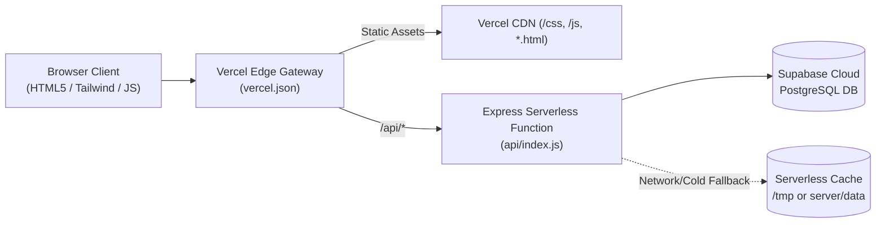

# 🖋️ Chronicle — Full Stack Editorial Web Publication


**Chronicle** is a high-performance, modern full-stack editorial publishing application designed for thoughtful writers and discerning readers. Built with vanilla JavaScript, modern Tailwind CSS, an Express REST backend, and Supabase PostgreSQL with automated resilient offline fallbacks.

---

## 🚀 Live Demo & Deployment

- **Vercel Serverless Ready**: Configured with `vercel.json` and `api/index.js` for instant serverless deployment.
- **GitHub Repository**: [CaptainB3465/Blog-Chronicle-App](https://github.com/CaptainB3465/Blog-Chronicle-App)

---

## 🌟 Key Features

### 1. 📖 Curated Editorial Discovery (`index.html`)
- **Hero Value Proposition**: High-contrast, typography-first editorial showcase.
- **Multi-Filter Explorer**: Instant categorization across *Engineering*, *Design*, *AI*, and *Culture*.
- **Interactive Search & Views**: Dynamic full-text search with instant toggle between Responsive Grid and Detailed List views.
- **Reading Drawer Overlay**: Quick preview of articles directly from the landing feed without context switching.

### 2. 🔐 Secure Multi-Tenant Authentication (`login.html`)
- **Unified Auth Portal**: Seamless animated tab switcher between **Log In** and **Create Account**.
- **Cryptographic Security**: Salted password hashing (bcryptjs 10 rounds) and 7-day signed JWT authentication tokens.
- **Password UX**: Real-time password strength meter, dynamic feedback badges, and visibility toggles.
- **Protected Route Guards**: Automatically intercepts unauthenticated visits to protected pages (`dashboard.html`, `create-blog.html`), redirects to login with return URLs, and restores target destinations after authentication.
- **Smooth Animated Logout**: Non-abrupt logout transition with alert toasts and automatic session clearance.

### 3. 📊 Author Studio & Reader Portal (`dashboard.html`)
- **Author Studio**:
  - Live editorial metrics: Published stories, claps received, drafts counter, and reader engagement count.
  - Multi-tenant story management: Dedicated `GET /api/blogs/user/me` endpoint ensures authors manage only their own publications.
  - Direct actions to edit, inspect, preview, or delete stories.
- **Client & Reader Portal**:
  - Saved articles & reading lists with one-click bookmarking.
  - Reader response tracking and engagement insights.
- **Account Settings & Profile Modal**:
  - Live update for display name, avatar URL, and user role via `PUT /api/auth/profile`.
  - Secure password update modal with salted bcrypt verification.
  - JWT Session Inspector displaying active token expiration and cryptographic header details.

### 4. ✍️ Distraction-Free Authoring Studio (`create-blog.html`)
- **Rich Markdown Formatting**: Instant toolbar shortcuts for headings (`H2`, `H3`), bold, italic, blockquotes, code blocks, and bullet lists.
- **Real-Time Split Preview**: Live Markdown rendering powered by `marked.js` with typographic styling.
- **Metadata Management**: Category selector, tag chips input, and Unsplash cover image integration with real-time thumbnail preview.
- **Draft & Publish Workflows**: Save unpublished working copies or publish immediately to the global feed.

### 5. 👓 Immersive Reading Experience (`blog.html`)
- **Distraction-Free Typography**: Optimized line heights, serif/sans-serif font scales, and dark/light themes.
- **Interactive Engagement**: Live clap counter with animated particles and dynamic reader comment submissions.
- **Reader Feedback Portal**: Dedicated modal to submit structured editorial feedback, bug reports, and ratings directly to the author.
- **Social Sharing**: Copy-to-clipboard article link, Twitter/X, and LinkedIn share integrations.

---

## 🏗️ Architecture & User Journey

```mermaid
flowchart TD
    Landing["Landing Explorer\n(index.html)"] -->|Unauthenticated| Login["Auth Portal\n(login.html)"]
    Login -->|Register / Sign In (JWT)| Dashboard["Author Studio\n(dashboard.html)"]
    Dashboard -->|Write Story| Editor["Create Studio\n(create-blog.html)"]
    Editor -->|Publish| Article["Article View\n(blog.html)"]
    Landing -->|Read Story| Article
    Article -->|Feedback Modal| FeedbackAPI["/api/feedback"]
    Editor -->|Save Post| BlogAPI["/api/blogs"]
    Dashboard -->|Manage Profile| AuthAPI["/api/auth"]
```

### Serverless & Database Architecture



---

## 💻 Tech Stack

| Layer | Technology | Description |
| :--- | :--- | :--- |
| **Frontend** | Vanilla JavaScript (ES6+) | Lightweight, dependency-free reactive client state |
| **Styling** | Tailwind CSS v4 & Custom Themes | Responsive design, CSS variables, dark/light theme switching |
| **Icons & Typography** | Lucide Icons & Google Fonts | Crisp vector iconography and Merriweather serif typography |
| **Markdown** | Marked.js | Instant client-side Markdown compilation |
| **Backend** | Node.js & Express.js 5 | Robust RESTful API architecture |
| **Authentication** | JSON Web Tokens (`jsonwebtoken`) & `bcryptjs` | Stateless signed token auth & 10-round salted password hashes |
| **Database** | Supabase (PostgreSQL) | Scalable relational storage for users, blogs, and feedback |
| **Data Resilience** | Serverless-Aware File Fallback | Automatic fallback to `/tmp` on read-only serverless platforms |
| **Deployment** | Vercel | Zero-configuration serverless hosting |

---

## 📡 REST API Reference

### Authentication Endpoints (`/api/auth`)

| Method | Endpoint | Auth | Description |
| :--- | :--- | :--- | :--- |
| `POST` | `/api/auth/register` | Public | Register new user account with salted bcrypt password |
| `POST` | `/api/auth/login` | Public | Authenticate user credentials and return 7-day JWT token |
| `GET` | `/api/auth/profile` | `Bearer <JWT>` | Retrieve authenticated user profile and session info |
| `PUT` | `/api/auth/profile` | `Bearer <JWT>` | Update user name, role, and avatar URL |
| `PUT` | `/api/auth/password` | `Bearer <JWT>` | Securely change user password |

### Blog Endpoints (`/api/blogs`)

| Method | Endpoint | Auth | Description |
| :--- | :--- | :--- | :--- |
| `GET` | `/api/blogs` | Public | List all blogs with optional category filter |
| `GET` | `/api/blogs/:id` | Public | Retrieve single blog post with full content & comments |
| `GET` | `/api/blogs/user/me` | `Bearer <JWT>` | Retrieve blogs authored exclusively by current user |
| `POST` | `/api/blogs` | `Bearer <JWT>` | Publish a new blog post |
| `PUT` | `/api/blogs/:id` | `Bearer <JWT>` | Update an existing blog post (author only) |
| `DELETE` | `/api/blogs/:id` | `Bearer <JWT>` | Delete a blog post (author only) |
| `POST` | `/api/blogs/:id/clap` | Public | Increment claps for an article |
| `POST` | `/api/blogs/:id/comments`| Public / Auth | Submit a reader comment |

### Feedback & Health (`/api`)

| Method | Endpoint | Auth | Description |
| :--- | :--- | :--- | :--- |
| `GET` | `/api/health` | Public | Server uptime and health probe |
| `GET` | `/api/feedback` | Public | List reader feedback and ratings |
| `POST` | `/api/feedback` | Public | Submit reader feedback and suggestions |

---

## 🛠️ Local Development Setup

### 1. Prerequisites
- **Node.js**: v18.0.0 or higher
- **npm**: v9.0.0 or higher
- **Git**

### 2. Clone Repository
```bash
git clone https://github.com/CaptainB3465/Blog-Chronicle-App.git
cd Blog-Chronicle-App
```

### 3. Install Dependencies
```bash
npm install
```

### 4. Configure Environment Variables
Copy `.env.example` to `.env`:
```bash
cp .env.example .env
```
Populate your `.env` variables:
```env
PORT=3000
JWT_SECRET=your-super-secret-jwt-key-min-32-chars
SUPABASE_URL=https://your-project.supabase.co
SUPABASE_SERVICE_ROLE_KEY=your-supabase-service-role-key
SUPABASE_PUBLISHABLE_KEY=your-supabase-publishable-key
```

### 5. Run Local Server
```bash
# Start server with auto-reload
npm run dev

# Or start in standard mode
npm start
```
Open [http://localhost:3000](http://localhost:3000) in your browser.

---

## 🚀 Step-by-Step Vercel Deployment Guide

Deploying Chronicle to Vercel takes under 2 minutes:

### Option A: Deploy via Vercel Web Dashboard (Recommended)

1. **Push your code to GitHub**:
   Ensure all changes are pushed to your `main` branch.

2. **Import Repository on Vercel**:
   - Go to [vercel.com/new](https://vercel.com/new).
   - Sign in with GitHub.
   - Locate and click **Import** next to `Blog-Chronicle-App`.

3. **Configure Build Settings**:
   - **Framework Preset**: Select **Other**.
   - **Root Directory**: `./` (leave default).
   - **Build Command**: Leave empty.
   - **Output Directory**: Leave empty.

4. **Add Environment Variables**:
   Under the **Environment Variables** accordion, add the following 4 keys:
   | Key | Value |
   | :--- | :--- |
   | `JWT_SECRET` | A secure random 32+ character string |
   | `SUPABASE_URL` | Your Supabase project URL (`https://xyz.supabase.co`) |
   | `SUPABASE_SERVICE_ROLE_KEY` | Your Supabase service role secret key |
   | `SUPABASE_PUBLISHABLE_KEY` | Your Supabase anon public key |

5. **Deploy**:
   - Click **Deploy**.
   - Vercel will build the serverless functions and provision the edge routing.
   - Once completed, click your assigned `*.vercel.app` production link!

---

### Option B: Deploy via Vercel CLI

```bash
# Install Vercel CLI globally (if not installed)
npm install -g vercel

# Log in to Vercel
vercel login

# Link and deploy
vercel

# Deploy to production with environment variables
vercel --prod
```

---

## 🔒 Security & Route Protection

1. **JWT Verification**: Protected endpoints verify tokens via HTTP `Authorization: Bearer <token>` headers using `server/middleware/auth.js`.
2. **Password Encryption**: All user passwords are encrypted using salted `bcryptjs` hashes before saving to Supabase or local caches. Plaintext passwords are never stored.
3. **Client-Side Route Guards**: `dashboard.html` and `create-blog.html` intercept unauthenticated visits before DOM rendering, displaying an informative toast and redirecting visitors to `login.html?redirect=<target>`.
4. **Serverless Filesystem Resilience**: Vercel functions execute in a read-only environment; Chronicle dynamically routes write buffers to `/tmp/chronicle_data` to prevent filesystem crashes (`EROFS`).

---

## 📄 License

This project is open-source and licensed under the [MIT License](LICENSE).
